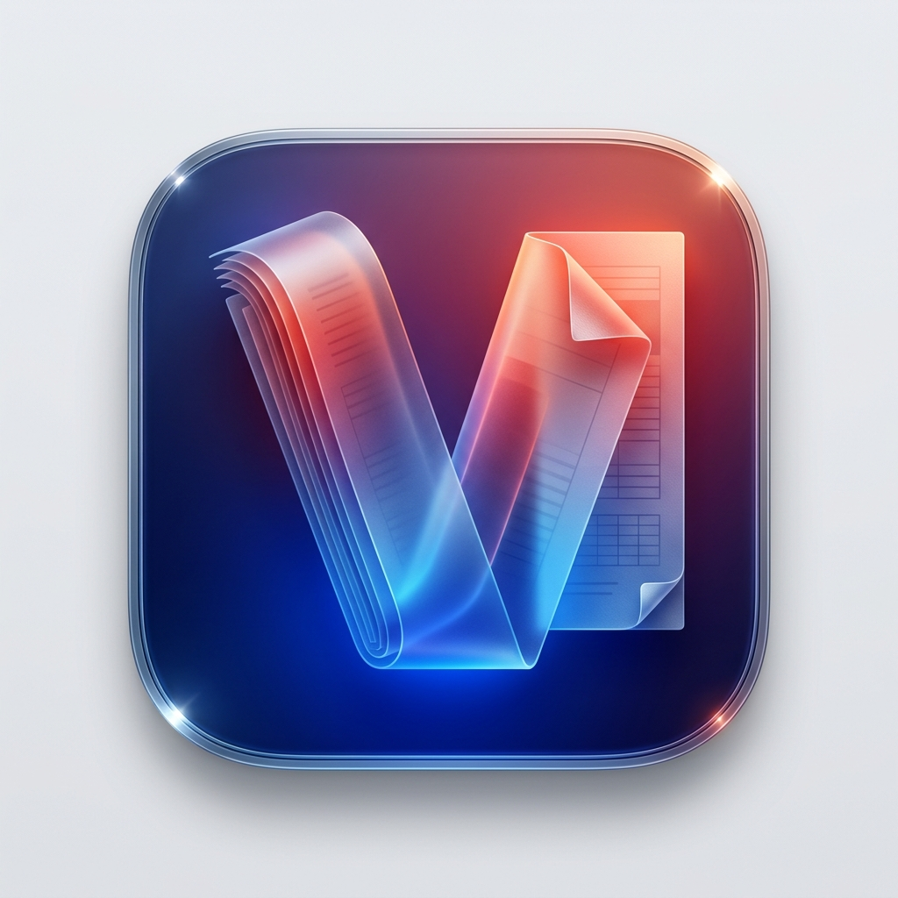

# vpdf — Leitor e Conversor de Arquivos PDF para macOS

<p align="center">
  
</p>

<p align="center">
  <a href="https://github.com/alexandrehenriqueventura/vpdf/actions/workflows/ci.yml">
    
  </a>
  <a href="https://github.com/alexandrehenriqueventura/vpdf/releases/latest">
    
  </a>
  
  
  
</p>

<p align="center">
  <b>Aplicativo nativo para macOS (14.0+ Sonoma / Sequoia) desenvolvido em Swift 5.9+ e SwiftUI.</b><br>
  Leitor de PDFs focado em agilidade, navegação hierárquica por pastas e conversão de documentos com estética limpa inspirada nas diretrizes de design do macOS (<i>Apple Human Interface Guidelines</i>).
</p>

<p align="center">
  👉 <b><a href="https://github.com/alexandrehenriqueventura/vpdf/releases/download/v1.0.0/vpdf-macos.zip">Baixar Versão Pré-compilada (vpdf-macos.zip)</a></b> 👈
</p>

---

## ⚡️ Instalação Rápida (Sem Compilar)

1. Baixe o **[vpdf-macos.zip](https://github.com/alexandrehenriqueventura/vpdf/releases/download/v1.0.0/vpdf-macos.zip)** na aba de Releases.
2. Dê um duplo clique para descompactar o arquivo **`vpdf.app`**.
3. Arraste para a sua pasta **Aplicativos** (`/Applications`) e abra!

> **Dica para o primeiro acesso (macOS Gatekeeper):**
> Por se tratar de um app de código aberto com assinatura local (*ad-hoc*), se o macOS mostrar o aviso de desenvolvedor não identificado, basta clicar com o **botão direito (ou Control + Clique)** sobre o `vpdf.app`, escolher **"Abrir"** e confirmar em **"Abrir"**.

---

## ✨ Principais Funcionalidades

- **Modo Apresentação em Tela Cheia (Slides e Apresentações)**:
  - Modo dedicado para apresentações com exibição em **Página Única (`.singlePage`)**, eliminando rolagens contínuas e respeitando rigorosamente a quebra de cada slide.
  - O slide é automaticamente centralizado e ajustado à tela cheia (`autoScales = true`) com fundo imersivo.
  - Navegação nativa via teclado: Setas (← e →), Espaço e Page Up / Page Down.
  - Painel flutuante discreto com indicador de slide (**`Slide 3 de 20`**), navegação e atalho `Esc` para retornar ao modo padrão.
  - Atalho rápido: **`⇧⌘F`** ou botão na barra superior.
- **Ferramenta de Busca Avançada Integrada**:
  - Barra de busca suspensa moderna (estilo Safari e Pré-Visualização do macOS) acionada por **`⌘F`**.
  - Contador de resultados em tempo real (ex.: **`3 de 15`** ou aviso visual caso não haja ocorrências).
  - Navegação entre ocorrências via botões Anterior (↑) e Próxima (↓) ou teclas `Enter` e `Shift+Enter`.
  - Destaque colorido imediato de todas as ocorrências na página e rolagem suave até a seleção ativa.
- **Barra de Ferramentas de Seleção e Marca-Texto (Anotações)**:
  - Ferramenta de anotação com **Realce em 4 Cores** (Amarelo, Verde, Azul e Rosa), criando marcações nativas no PDF (`PDFAnnotation` persistível).
  - Ferramentas usuais de texto: **Sublinhar**, **Tachar**, **Copiar seleção (`⌘C`)** e **Remover realces**.
  - Acionada pelo botão de marca-texto na barra superior.
- **Menu de Botão Direito (Context Menu) 100% em Português do Brasil**:
  - Subclasse customizada do `PDFView` com tradução completa de todos os comandos do AppKit para pt-BR: *Copiar*, *Selecionar Tudo*, *Página Única (Slide)*, *Rolagem Contínua*, *Ajustar à Janela*, *Realçar com Cor*, *Sublinhar*, *Tachar*, *Consultar no Dicionário*, entre outros.
- **Visualizador Nativo de PDF (PDFKit) com Barra de Zoom e Paginação Elegante**:
  - Renderização vetorial cristalina com suporte a páginas contínuas, zoom fluído e seleção de texto nativa do macOS.
  - **Barra de Zoom e Paginação Flutuante (Glassmorphism)**: Controle em cápsula translúcida (`.ultraThinMaterial`) com:
    - Indicador dinâmico de página atual e total (ex: **`1 de 100`**) em tipografia tabular monospaçada (`monospacedDigit()`), perfeitamente integrado sem deformar o design da barra.
    - Botões de zoom in/out (`⌘+` / `⌘-`), slider contínuo de escala, menu de escalas rápidas (50%, 75%, 100%, 150%, 200%, 300%) e botão de ajuste automático à largura da janela (`⇧⌘0`).
  - Rolagem suave com alta performance, mesmo em documentos com centenas de páginas.
  - Busca de termos integrada no PDF com salto automático para a primeira ocorrência e destaque de resultados.
- **Conversão Avançada de PDF para Word (.docx e .doc) Preservando Formatação**:
  - Ao converter de PDF para Word, o motor do `vpdf` extrai a árvore tipográfica rica de cada página (`PDFPage.attributedString`), preservando **tamanhos de fonte originais (títulos, subtítulos, corpo), pesos (negrito/itálico), cores de texto e separação de parágrafos**, sem achatar o conteúdo para texto puro.
  - Normalização inteligente de fontes de sistema para fontes padrão de mercado (como Helvetica/Arial) para total compatibilidade com o Microsoft Word em qualquer plataforma.
- **Conversor Nativo de Documentos Word (.docx e .doc) para PDF**:
  - Conversão instantânea de arquivos Microsoft Word (`.docx` e `.doc`) diretamente para `.pdf` paginado em padrão A4 via `NSAttributedString` e `CoreText`, sem depender de LibreOffice ou bibliotecas externas.
  - Acessível diretamente pelo botão na barra de ferramentas ou na tela inicial do app.
- **Barra Lateral com Árvore de Diretórios (NavigationSplitView)**:
  - Listagem inteligente filtrada **exclusivamente para arquivos PDF e pastas**, eliminando ruídos visuais de mídias ou arquivos não suportados.
  - Carregamento preguiçoso (*lazy loading* assíncrono) que carrega o conteúdo de subpastas apenas quando o usuário as expande.
  - Suporte ao atalho nativo do macOS para recolher/expandir a barra lateral (`⌃⌘S`).
- **Conversão de Documentos (ConversionService)**:
  - Converte documentos entre múltiplos formatos:
    - **Word (.docx)**: Documento do Microsoft Word gerado nativamente via `officeOpenXML`.
    - **TXT**: Texto simples formatado em UTF-8.
    - **RTF**: Documento com cabeçalho RTF válido (`{\rtf1`) via `NSAttributedString`.
    - **HTML5**: Documento autocontido com CSS tipográfico responsivo (*dark/light mode*).
    - **PDF**: Reexportação paginada no padrão A4 via `CoreText` e `PDFKit`.
- **Barra de Rodapé com Metadados**:
  - Exibe em tempo real o número total de páginas do PDF, quebra de linha (`LF`), contagem de palavras e caracteres, e status de salvamento.
- **App Sandbox e Permissões Persistentes**:
  - Conformidade total com os padrões de segurança da Apple.
  - As autorizações concedidas pelo usuário via `NSOpenPanel` são salvas como *Security-Scoped Bookmarks* no `UserDefaults`, restaurando a pasta aberta automaticamente entre reinicializações do app.

---

## 🏛 Arquitetura e Decisões de Design

- **Padrão MVVM com `@Observable`**: Utiliza o framework moderno `Observation` nativo do Swift 5.9 / macOS 14+, garantindo renderizações cirúrgicas de UI sem a sobrecarga do clássico `ObservableObject`.
- **AppKit onde o SwiftUI é insuficiente**:
  - `PDFViewerRepresentable` encapsula o `PDFView` com controle de busca, escalonamento automático e quebra de páginas.
  - `TextEditorRepresentable` encapsula `NSTextView` para edição rápida e busca incremental.
- **Zero Dependências Externas**: Criado 100% com os frameworks nativos da Apple (`SwiftUI`, `AppKit`, `PDFKit`, `CoreText`, `UniformTypeIdentifiers`).
- **Operações Assíncronas (`async/await`)**: Leitura em disco, decodificação e processamento de arquivos são delegados para threads secundárias (`Task.detached`), mantendo a fluidez da interface a 60/120 fps.

---

## 📁 Estrutura do Projeto

```text
vpdf/
├── Package.swift                    # Configuração SPM (Swift Package Manager)
├── build_app.sh                     # Script de compilação e montagem do vpdf.app
├── run_tests.sh                     # Executor da suíte de testes unitários
├── vpdf.xcodeproj/                  # Projeto nativo configurado para o Xcode
│   └── project.pbxproj
├── Sources/
│   └── vpdf/
│       ├── App.swift                # Ponto de entrada do aplicativo (@main)
│       ├── Models/
│       │   ├── AppError.swift       # Erros de aplicação amigáveis
│       │   ├── ConversionFormat.swift # Formatos suportados (PDF, Word DOCX/DOC, TXT, MD, RTF, HTML)
│       │   └── FileItem.swift       # Modelo de arquivo/pasta na árvore
│       ├── Services/
│       │   ├── FileSystemService.swift # Sandboxing, Bookmarks e navegação em disco
│       │   ├── EncodingService.swift   # Detecção precisa de codificação de texto
│       │   └── ConversionService.swift # Motores de conversão (CoreText, Word DOCX, RTF, HTML5)
│       ├── ViewModels/
│       │   └── AppViewModel.swift   # Estado reativo e orquestração MVVM
│       ├── Views/
│       │   ├── ContentView.swift    # NavigationSplitView, Toolbar e área de leitura
│       │   ├── PDFViewerRepresentable.swift # Ponte para o PDFView nativo com sincronização de zoom
│       │   ├── PDFZoomControlBar.swift      # Barra flutuante translúcida de controle de zoom
│       │   ├── TextEditorRepresentable.swift# Ponte para NSTextView
│       │   ├── EmptyStateView.swift # Tela de boas-vindas com botão de conversão rápida
│       │   ├── FileRowView.swift    # Linha de exibição de itens na barra lateral
│       │   └── StatusBarView.swift  # Rodapé com metadados do documento
│       └── Resources/
│           ├── Info.plist           # Metadados e identificação do bundle macOS
│           └── vpdf.entitlements    # Permissões do App Sandbox
└── Tests/
    ├── TestRunner.swift             # Runner de testes via linha de comando (13 testes)
    └── vpdfTests/
        ├── EncodingServiceTests.swift   # Testes de detecção de codificação
        └── ConversionServiceTests.swift # Testes de conversão, paginação A4 e Word DOCX
```

---

## ⌨️ Atalhos de Teclado Nativos

| Atalho | Ação |
| :--- | :--- |
| **`⇧⌘O`** | Abrir nova pasta no disco |
| **`⌘S`** | Salvar alterações |
| **`⇧⌘E`** | Exportar documento no formato selecionado |
| **`⌘F`** | Buscar termo no documento PDF |
| **`⌃⌘S`** | Recolher / expandir barra lateral |
| **`⌘+`** / **`⌘=`** | Aumentar zoom do visualizador de PDF |
| **`⌘-`** | Reduzir zoom do visualizador de PDF |
| **`⌘0`** | Redefinir zoom para o tamanho real (100%) |
| **`⇧⌘0`** | Ajustar zoom automaticamente à largura da janela (*Fit*) |

---

## 🚀 Como Compilar e Executar

### 1. Compilação em 1 Clique (Terminal)
Você pode compilar o código-fonte, montar o pacote macOS e assiná-lo com sandbox executando:

```bash
./build_app.sh
```

Para abrir o aplicativo imediatamente após a compilação:
```bash
open vpdf.app
```
*(Ou dê um duplo clique no arquivo `vpdf.app` no Finder).*

### 2. Abrindo no Xcode
1. Abra o projeto diretamente com o comando:
   ```bash
   xed .
   # ou
   open vpdf.xcodeproj
   ```
2. Selecione o esquema **`vpdf`** e o destino **`My Mac`**.
3. Pressione `⌘R` para executar com depuração interativa.

### 3. Executando os Testes Unitários
O projeto inclui **14 testes unitários automatizados** validando detecção de codificação, paginação A4 vetorial, conversão bidirecional Word ↔ PDF e preservação de estilos tipográficos:

```bash
./run_tests.sh
```

**Resultado esperado:**
```text
========================================
INICIANDO SUÍTES DE TESTES UNITÁRIOS
========================================
▶ Testando EncodingService...
  ✓ testEmptyData passou
  ✓ testUTF8WithoutBOM passou
  ✓ testUTF8WithBOM passou
  ✓ testUTF16LEWithBOM passou
  ✓ testUTF16BEWithBOM passou
  ✓ testWindows1252Encoding passou
  ✓ testISO88591Latin1Encoding passou

▶ Testando ConversionService...
  ✓ testPlainTextConversion passou
  ✓ testRTFConversion passou
  ✓ testHTMLConversion passou
  ✓ testPDFConversion (1 página) passou
  ✓ testMultiPagePDFConversion (9 páginas) passou
  ✓ testWordDocxToPDFConversion (1 página) passou
  ✓ testPDFToWordDocxPreservingFormatting passou

========================================
TODOS OS 14 TESTES PASSARAM COM SUCESSO! 🎉
========================================
```

---

## 📄 Licença
Distribuído sob a licença MIT. Consulte o arquivo de licença para mais informações.
